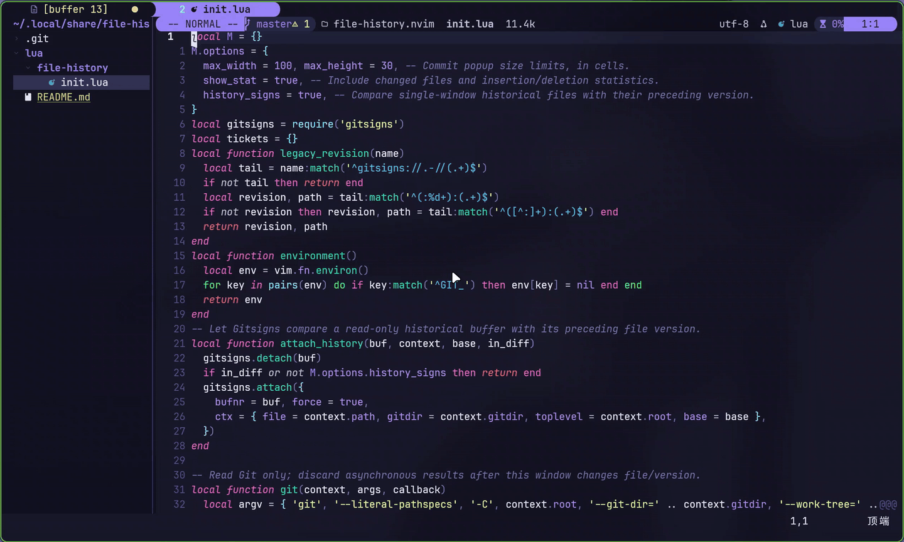
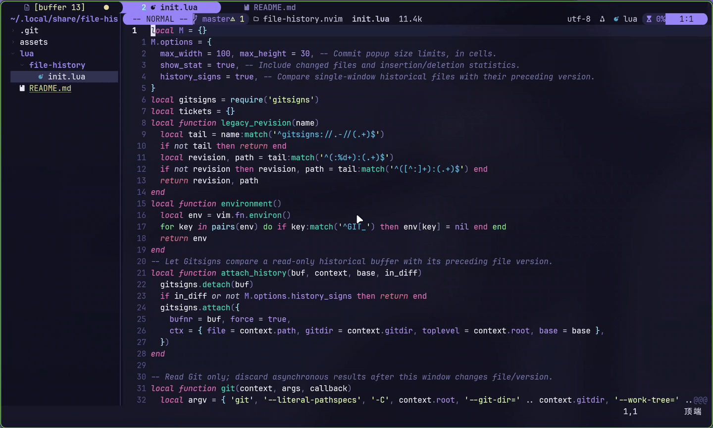

# file-history.nvim

Browse a file's Git versions in the focused Neovim window, without replacing its working buffer.



`[v` / `]v` browse older / newer versions; `<leader>hl` shows commit details and
colored diffstat. These are example mappings, with Space as leader in the demos.
Version labels use `label()` in the tabline/statusline.



`<leader>hd` compares against HEAD. Each side can navigate independently, all the
way to the oldest file version and back. `Space w q` is a custom mapping for
`:q`, not a plugin default.

## Installation

Requires Neovim 0.12+, Git, and [Gitsigns](https://github.com/lewis6991/gitsigns.nvim)
with the documented `attach(ctx)` and `b:gitsigns_status_dict` APIs. Configure
Gitsigns first. This plugin supplies no default mappings or background processes.

### vim.pack

```lua
vim.pack.add {
  'https://github.com/lewis6991/gitsigns.nvim',
  'https://github.com/zxzxn3/file-history.nvim',
}
require('gitsigns').setup {}
require('file-history').setup {}
vim.keymap.set('n', '[v', function() require('file-history').step(1) end)
vim.keymap.set('n', ']v', function() require('file-history').step(-1) end)
vim.keymap.set('n', '<leader>hl', function() require('file-history').log() end)
vim.keymap.set('n', '<leader>hd', function() require('file-history').diff() end)
```

### lazy.nvim

```lua
{
  'zxzxn3/file-history.nvim',
  dependencies = { { 'lewis6991/gitsigns.nvim', opts = {} } },
  config = function() require('file-history').setup {} end,
}
```

Add your mappings separately, for example those shown above.

## Configuration

All options are optional; these are the defaults:

```lua
require('file-history').setup {
  max_width = 100,       -- Commit popup width, in cells.
  max_height = 30,       -- Commit popup height, in cells.
  show_stat = true,     -- Include changed-file statistics in the popup.
  history_signs = true, -- Compare a revision with the preceding file version.
}
```

Gitsigns supplies repository context. For bare repositories, ensure it attaches
first; a helper such as baredot can provide that context. Navigation asks you to
wait if attachment is not ready.

## Usage

Commands mirror the Lua API: `:FileHistoryOlder`, `:FileHistoryNewer`,
`:FileHistoryDiff`, and `:FileHistoryLog`.

- Navigation: working buffer → newest file commit → older file commits.
- Diff: HEAD on the left, the invoking view on the right. Navigate either side
  independently; `:q` closes a window and `:diffoff!` leaves diff mode. Repeating
  the diff command does not create another split while already in diff mode.
- Historical signs compare against the preceding file commit and are suppressed
  in diff mode. Hidden historical buffers are wiped.
- Commit details show metadata, message and colored diffstat. From a working
  file, they describe HEAD.

`require('file-history').label(bufnr)` returns `[revision] filename`, or nil for a
working buffer. Use it in your own statusline/tabline formatter; the plugin does
not configure those plugins. Historical views are read-only. If you have custom
staging/reset mappings, disable them when `vim.b.file_history` is present.

## Scope

- Only commits touching the current path are visited. Deletion commits are
  skipped; renames are not followed. INDEX navigation is not supported.
- Repositories need a HEAD commit; diff also requires the file to exist in HEAD.
  Binary previews are not supported.
- Sessions do not preserve historical buffer contents. Discard empty
  `history://` placeholders on restore, or navigate again to reload them.
- Navigation is asynchronous. Switching file/version or closing the requesting
  window cancels stale results. Rapid steps replace pending requests rather than
  queue every keypress.

<details>
<summary>Validation scope</summary>

Checked with Neovim 0.12.6 and Gitsigns `851a051` using isolated Git repositories,
including a bare repository with a linked worktree. Checks cover navigation,
unsaved-buffer preservation, historical signs, independent diff views, stale
asynchronous results, buffer cleanup, and commit popups. The demos show the
interactive behavior in Neovide. The lazy.nvim example was reviewed against its
loading rules but was not run with lazy.nvim.

</details>
